# Exoplanet Detection System (TESS Survey Transit Pipeline)

[](https://www.python.org/)
[](LICENSE)
[](https://heasarc.gsfc.nasa.gov/docs/tess/tess.html)
[](https://xgboost.readthedocs.io/)
[](#differentiator-3-paras-2-follow-up-priority-index-pfi)

An end-to-end, scientifically calibrated exoplanet detection platform that reads raw NASA TESS (Transiting Exoplanet Survey Satellite) FITS files, cleans and detrends light curves, runs a Box Least Squares (BLS) transit search, fits a physical trapezoid model using Levenberg-Marquardt optimization, extracts 14 unified shape features, and runs them through a pre-trained XGBoost classifier to identify **Exoplanets (Planets)**, **Eclipsing Binaries (EBs)**, and **False Positives (FPs)**.

Includes a Flask API backend and an interactive, React-based scientific dashboard.

---

## Unified Ingestion & Processing Flowchart
This diagram outlines the complete multi-stage processing pipeline implemented from Slide 7 of the Voyager 3 architecture deck:

```mermaid
graph TD
    subgraph Stage1["STAGE 1 & 2: Ingestion & Detrending"]
        FITS[TESS FITS files] --> Ingest[Read FITS Binary Tables]
        Ingest --> Filter[Quality Flag Filtering]
        Filter --> Base[Savitzky-Golay Baseline Estimation]
        Base --> Norm[Stellar Flux Normalization]
    end

    subgraph Stage2["STAGE 3: BLS Transit Detection"]
        Norm --> BLS[Weighted BLS Search: 6000 period grid / 50 duration grid]
        BLS --> Period[Identify Best Period, Epoch, Depth, & Power]
    end

    subgraph Stage3["STAGE 4 & 5: Folding & Fitting"]
        Period --> Fold[Phase Fold & Crop Data]
        Fold --> LM[Levenberg-Marquardt Trapezoid Fitting]
        LM --> Params[Extract Fitted Parameters: depth, T_tot, T_in, chi2_red, RMS]
    end

    subgraph Stage4["STAGE 6 & 7: Feature Engineering & AI"]
        Params --> Feat[Extract 25 Physics & Morphology Features]
        Feat --> XGB[XGBoost Classifier: 5-Fold Stratified Cross-Validation]
        XGB --> Pred[Class Prediction: Planet / EB / False Positive]
    end

    subgraph Stage5["STAGE 8 & 9: Confidence & Ranking"]
        Pred --> Conf[Multi-Stage Confidence Assessment: SNR, SDE, FAP, red_chi2]
        Conf --> PFI[PARAS-2 Follow-up Index: log-scaled prioritization]
        PFI --> Output[High-Priority Target Candidate list for Telescope Follow-up]
    end

    %% Style definitions for high contrast on all themes
    classDef nodeStyle fill:#1e293b,stroke:#475569,stroke-width:1px,color:#f8fafc;
    class FITS,Ingest,Filter,Base,Norm,BLS,Period,Fold,LM,Params,Feat,XGB,Pred,Conf,PFI,Output nodeStyle;

    style Stage1 fill:#0f172a,stroke:#334155,stroke-width:1px,color:#f1f5f9
    style Stage2 fill:#0f172a,stroke:#334155,stroke-width:1px,color:#f1f5f9
    style Stage3 fill:#0f172a,stroke:#334155,stroke-width:1px,color:#f1f5f9
    style Stage4 fill:#0f172a,stroke:#334155,stroke-width:1px,color:#f1f5f9
    style Stage5 fill:#0f172a,stroke:#334155,stroke-width:1px,color:#f1f5f9
```



---

## Detailed Pipeline Stages

### 1. Ingestion & Detrending (`src/pipeline/fits_reader.py`, `src/pipeline/preprocessing.py`)
- **Quality Filtering**: Discards bad cadences where $\text{QUALITY} \neq 0$ to remove background flares, cosmic rays, and satellite wiggles.
- **Savitzky-Golay Detrending**: Estimates the local stellar baseline $B(t)$ by fitting a local polynomial of degree $d$ over a sliding window of length $W$:
  $$y_i = \sum_{j=0}^{d} c_j i^j$$
  We employ $W=1001$ cadences and $d=2$.
- **Relative Residuals**: Produces `Normalized_Flux` ($F_{\text{norm}}$) and relative residuals `Detrended_Flux` ($F_{\text{det}}$) centered around $0.0$:
  $$F_{\text{norm}}(t) = \frac{F(t)}{B(t)}, \quad F_{\text{det}}(t) = \frac{F(t) - B(t)}{B(t)}$$

### 2. Box Least Squares (BLS) Search (`src/pipeline/bls_detector.py`)
Scans the detrended light curve sector-by-sector for periodic, box-like transit dips.
- **Search Grid**: Searches a linear grid of **6,000 trial periods** between 0.5 and 15.0 days, and **50 trial durations** (approx. 1 to 12 hours).
- **BLS Power Metric**: Computes the chi-squared difference between a flat line model and a periodic step-function transit model:
  $$\text{Power}(P) = \Delta \chi^2(P) = \chi^2_{\text{flat}} - \chi^2_{\text{transit}}(P) = \frac{\left( \sum w_i (y_i - 1) \right)^2}{\sum w_i}$$
  where the weights are $w_i = \frac{1}{\sigma_{F, \text{norm}, i}^2}$ (inverse-variance weighting using $dy$).

### 3. Trapezoidal Model Fitting (`src/pipeline/trapezoid_fit.py`, `src/pipeline/phase_folding.py`)
- **Phase Folding**: Folds the light curve around the detected period ($P$) and epoch ($T_0$), centering the phase domain in $[-0.5, 0.5]$:
  $$\phi(t) = \left( \frac{t - T_0 + 0.5 P \pmod P}{P} \right) - 0.5$$
- **Levenberg-Marquardt Optimization**: Fits a physical trapezoid model to the folded data inside a window cropped to 3 times the transit width. The model extracts transit depth ($\delta$), total duration ($T_{\text{tot}}$), ingress duration ($T_{\text{in}}$), and reduced $\chi^2$.

---

## Key Differentiators 

### Differentiator 1: Physics-Guided Transit Shape Discriminants
Instead of feeding raw, noisy flux curves into black-box neural networks, we extract physical transit shape metrics to separate exoplanets, eclipsing binaries, and background blends:

| Calculated Metric | Calculation Method | Exoplanet (Planet) | Binary System (EB) | Blend Candidate (FP) |
| :--- | :--- | :--- | :--- | :--- |
| **Light Curve Shape** | Graph Plotting | Symmetric U-shape | Deep U/V-shape | Distorted / Asymmetric |
| **Ingress Fraction ($I_f$)** | $T_{\text{in}} / T_{\text{tot}}$ | Short ingress | Extended ingress | Irregular ingress |
| **Flat-Bottom Fraction ($\tau$)** | $T_{\text{flat}} / T_{\text{tot}}$ | Broad flat-bottom | Narrow / Absent | Poorly defined |
| **Odd-Even Depth Ratio ($R_{oe}$)** | $D_{\text{odd}} / D_{\text{even}}$ | $\approx 1$ | $\neq 1$ | Inconsistent |
| **Secondary Eclipse Depth ($\delta_{\text{sec}}$)** | $1 - F_{\text{sec}}$ | Not Detected | Detected | Ambiguous |
| **Transit Depth ($\delta$)** | $1 - F_{\text{min}}$ | Shallow | Deep | Diluted |

---

### Differentiator 2: Multi-Stage Scientific Confidence Assessment
Detection confidence is established through signal quality, statistical significance, model consistency, and AI classification confidence:

| Confidence Metric | Formula / Representation | Computed From | What Questions We Answered |
| :--- | :--- | :--- | :--- |
| **Transit Signal-to-Noise Ratio (SNR)** | $\text{SNR} = \left(\frac{\delta}{\sigma_{1h}}\right) \sqrt{N_{\text{tr}}}$ | Transit Depth ($\delta$) + Out-of-transit RMS noise | Is the detected transit distinguishable from the photometric noise? |
| **Signal Detection Efficiency (SDE)** | $\text{SDE} = \frac{\text{SR} - \mu_{\text{SR}}}{\sigma_{\text{SR}}}$ | Weighted BLS Periodogram | How significant is the detected period relative to all trial periods? |
| **False Alarm Probability (FAP)** | $\text{FAP} = \frac{N_{\text{boot}}(\text{SR} \ge \text{SR}_{\text{obs}})}{N_{\text{boot}}}$ | BLS Peak Significance | Could the detected periodic signal arise purely from random noise? |
| **Reduced $\chi^2$ (Goodness-of-Fit)** | $\chi^2_{\text{red}} = \frac{\chi^2}{N - p}$ | Trapezoid Transit Fit Residuals | Does the fitted transit model accurately represent the observed light curve? |
| **XGBoost Posterior Probability** | $P(\text{Class} \mid X)$ | Engineered Physics Feature Vector | Which astrophysical class best matches the extracted transit features? |

---

### Differentiator 3: PARAS-2 Follow-up Priority Index (PFI)
AI predictions alone are insufficient for prioritizing telescope time. Voyager 3 implements the **PARAS-2 Follow-Up Index (PFI)**, combining classification confidence with physical significance to prioritize telescope hours:

$$\text{PFI} = \text{XGBoost's Probability of Planet} \times \ln(\text{Transit SNR}) \times (1 - \text{FAP})$$

This prioritizes high-confidence, high-SNR, low-FAP targets for ground-based radial velocity (RV) follow-up, ensuring telescope time is spent on the most promising candidates.

---

## How to Run Locally

### Prerequisites
- Python 3.9+
- Node.js 18+

### Setup & Run
1. Clone the repository and navigate to the project directory.
2. Install Python dependencies:
   ```bash
   pip install -r requirements.txt
   ```
3. Install Node dependencies:
   ```bash
   npm install
   ```
4. Start both the Python API backend and React dev frontend concurrently:
   ```bash
   npm run dev
   ```
5. Open your browser and navigate to:
   **[http://localhost:5173](http://localhost:5173)** (or the port specified in the terminal).
