```mermaid
graph TD
    subgraph Stage1["STAGE 1 & 2: Ingestion & Detrending"]
        FITS[TESS FITS files] --> Ingest[Read FITS Binary Tables]
        Ingest --> Filter[Quality Flag Filtering]
        Filter --> Base[Savitzky-Golay Baseline Estimation]
        Base --> Norm[Stellar Flux Normalization]
    end

    subgraph Stage2["STAGE 3: BLS Transit Detection"]
        Norm --> BLS[Weighted BLS Search: 6000 period grid / 50 duration grid]
        BLS --> Period[Identify Best Period, Epoch, Depth, & Power]
    end

    subgraph Stage3["STAGE 4 & 5: Folding & Fitting"]
        Period --> Fold[Phase Fold & Crop Data]
        Fold --> LM[Levenberg-Marquardt Trapezoid Fitting]
        LM --> Params[Extract Fitted Parameters: depth, T_tot, T_in, chi2_red, RMS]
    end

    subgraph Stage4["STAGE 6 & 7: Feature Engineering & AI"]
        Params --> Feat[Extract 25 Physics & Morphology Features]
        Feat --> XGB[XGBoost Classifier: 5-Fold Stratified Cross-Validation]
        XGB --> Pred[Class Prediction: Planet / EB / False Positive]
    end

    subgraph Stage5["STAGE 8 & 9: Confidence & Ranking"]
        Pred --> Conf[Multi-Stage Confidence Assessment: SNR, SDE, FAP, red_chi2]
        Conf --> PFI[PARAS-2 Follow-up Index: log-scaled prioritization]
        PFI --> Output[High-Priority Target Candidate list for Telescope Follow-up]
    end

    %% Style definitions for high contrast on all themes
    classDef nodeStyle fill:#1e293b,stroke:#475569,stroke-width:1px,color:#f8fafc;
    class FITS,Ingest,Filter,Base,Norm,BLS,Period,Fold,LM,Params,Feat,XGB,Pred,Conf,PFI,Output nodeStyle;

    style Stage1 fill:#0f172a,stroke:#334155,stroke-width:1px,color:#f1f5f9
    style Stage2 fill:#0f172a,stroke:#334155,stroke-width:1px,color:#f1f5f9
    style Stage3 fill:#0f172a,stroke:#334155,stroke-width:1px,color:#f1f5f9
    style Stage4 fill:#0f172a,stroke:#334155,stroke-width:1px,color:#f1f5f9
    style Stage5 fill:#0f172a,stroke:#334155,stroke-width:1px,color:#f1f5f9
```

# 🚀 AI-Enabled Detection of Exoplanets from Noisy Astronomical Light Curves
### **Bharatiya Antariksh Hackathon (BAH) 2026**
**Team Name:** Voyager 3  
**College:** Acropolis Institute of Technology and Research  

---

## 👩‍💻 Author & Lead Developer
*   **Nandini Gupta**: End-to-End Pipeline Orchestration, AI Classifier Development, Feature Engineering, Physical Modeling & Architecture

---

## 🌌 Project Overview
Voyager 3 is an end-to-end, scientifically calibrated exoplanet detection platform designed to automate the discovery of transiting exoplanets from raw NASA TESS (Transiting Exoplanet Survey Satellite) FITS files. 

The pipeline ingests raw light curves, filters quality anomalies, detrends stellar variability, performs a Box Least Squares (BLS) transit search, fits a physical trapezoid model using Levenberg-Marquardt optimization, extracts 24 morphological and astrophysical shape features, and runs them through a trained XGBoost classifier to identify:
1.  **Exoplanet Candidates (Planets)**
2.  **Eclipsing Binaries (EBs)**
3.  **False Positives (FPs)** (instrumental noise, background stars, or stellar variability)

To solve the key challenge of limited follow-up resources, we introduce the **PARAS-2 Follow-up Priority Index (PFI)**, which rank-orders targets to optimize telescope follow-up hours.

---

## 📊 Unified Ingestion & Processing Flowchart
This diagram outlines the complete multi-stage processing pipeline implemented in the Voyager 3 architecture:



---

## ⚙️ Detailed Pipeline Stages & Mathematical Background

### 1. Ingestion & Quality Filtering
We ingest NASA TESS files in `.fits` format. Discards bad cadences where the quality flag $\text{QUALITY} \neq 0$ (e.g., removing background flares, cosmic rays, instrument wiggles, and sensor anomalies).

### 2. Savitzky-Golay Detrending
To isolate the transit signal, we model and subtract low-frequency stellar variability (rotation, spots, pulsations) using a Savitzky-Golay filter. Over a moving window $W$, it fits a local polynomial of degree $d$:
$$y_i = \sum_{j=0}^{d} c_j i^j$$
*   We use a window size of $W = 1001$ cadences and polynomial degree of $d = 2$.
*   Relative residuals (Detrended Flux $F_{\text{det}}$) centered around $0.0$ are calculated as:
$$F_{\text{norm}}(t) = \frac{F(t)}{B(t)}, \quad F_{\text{det}}(t) = \frac{F(t) - B(t)}{B(t)}$$
where $B(t)$ represents the estimated stellar baseline.

### 3. Box Least Squares (BLS) Search
We run a weighted periodic Box Least Squares transit search on $F_{\text{det}}$:
*   **Search Parameters**: 6,000 trial periods (0.5 to 15 days) and 50 trial durations (1 to 12 hours).
*   **Weighted Power**: Invokes inverse-variance weighting using flux uncertainties $\sigma_{i}$ to compute the chi-squared difference between a flat line model and a periodic transit model:
$$\text{Power}(P) = \Delta \chi^2(P) = \chi^2_{\text{flat}} - \chi^2_{\text{transit}}(P) = \frac{\left( \sum w_i (y_i - 1) \right)^2}{\sum w_i}$$
where $w_i = \frac{1}{\sigma_i^2}$.

### 4. Phase Folding & Trapezoidal Model Fitting
*   **Phase Folding**: Folds the light curve around the detected period ($P$) and epoch ($T_0$), centering the phase domain in $[-0.5, 0.5]$:
$$\phi(t) = \left( \frac{t - T_0 + 0.5 P \pmod P}{P} \right) - 0.5$$
*   **Levenberg-Marquardt Trapezoidal Fit**: We fit a physical 4-parameter trapezoid model (depth $\delta$, total duration $T_{\text{tot}}$, ingress duration $T_{\text{in}}$, and epoch offset $t_0$) inside a cropped window to extract clean transit morphology.

### 5. Multi-Stage Scientific Confidence Metrics
*   **Transit Signal-to-Noise Ratio (SNR)**:
$$\text{SNR} = \left(\frac{\delta}{\sigma_{1h}}\right) \sqrt{N_{\text{tr}}}$$
*   **Signal Detection Efficiency (SDE)**:
$$\text{SDE} = \frac{\text{SR}_{\text{obs}} - \mu_{\text{SR}}}{\sigma_{\text{SR}}}$$
*   **False Alarm Probability (FAP)**: Estimating signal probability from bootstrap resampling:
$$\text{FAP} = \frac{N_{\text{boot}}(\text{SR} \ge \text{SR}_{\text{obs}})}{N_{\text{boot}}}$$
*   **Reduced $\chi^2$ (Goodness-of-Fit)**:
$$\chi^2_{\text{red}} = \frac{\chi^2}{N - p}$$

---

## ⚡ Key Scientific Differentiators

### Differentiator 1: Physics-Guided Transit Shape Discriminants
Instead of feeding raw, noisy flux curves into black-box neural networks, we extract physical transit shape metrics to separate exoplanets, eclipsing binaries, and background blends:

| Calculated Metric | Calculation Method | Exoplanet (Planet) | Binary System (EB) | Blend Candidate (FP) |
| :--- | :--- | :--- | :--- | :--- |
| **Light Curve Shape** | Graph Plotting | Symmetric U-shape | Deep U/V-shape | Distorted / Asymmetric |
| **Ingress Fraction ($I_f$)** | $T_{\text{in}} / T_{\text{tot}}$ | Short ingress | Extended ingress | Irregular ingress |
| **Flat-Bottom Fraction ($\tau$)** | $T_{\text{flat}} / T_{\text{tot}}$ | Broad flat-bottom | Narrow / Absent | Poorly defined |
| **Odd-Even Depth Ratio ($R_{oe}$)** | $D_{\text{odd}} / D_{\text{even}}$ | $\approx 1$ | $\neq 1$ | Inconsistent |
| **Secondary Eclipse Depth ($\delta_{\text{sec}}$)** | $1 - F_{\text{sec}}$ | Not Detected | Detected | Ambiguous |
| **Transit Depth ($\delta$)** | $1 - F_{\text{min}}$ | Shallow | Deep | Diluted |

---

### Differentiator 2: PARAS-2 Follow-up Priority Index (PFI)
To solve the bottleneck of limited telescope follow-up time, we developed the **PARAS-2 Follow-up Priority Index (PFI)**. This combines the ML classification confidence with physical detection significance to rank candidates:

$$\text{PFI} = P(\text{Planet}) \times \ln(\text{Transit SNR}) \times (1 - \text{FAP})$$

Targets with a higher PFI score represent high-probability, high-significance, low-noise exoplanet candidates that warrant radial velocity (RV) follow-up using spectrographs like PARAS-2.

---

## 🛠️ Latest Robustness & Stability Optimizations
During physical evaluation sweeps of the complete 1,612 star catalog, we encountered and resolved several edge-case pipeline failure modes:
1.  **Strict Mode Ingestion Race Condition**: Refactored the batch processing loop from a React state-dependent effect to a single, sequential, locking `for` loop. This avoids the concurrent double-triggers introduced by React Strict Mode, which caused targets to be skipped.
2.  **Large Payload Auto-Parsing**: Added string-matching checks to auto-parse responses. Very large FITS sweeps (containing 260K+ characters of plot coordinates) sometimes arrive as raw strings due to proxy chunking limits, and are now successfully parsed.
3.  **NaN / Infinity Response Sanitization**: Added a recursive python sanitizer `sanitize_json_value(response)` to automatically clean up all metrics containing `NaN` or `inf` before Flask serialization. These are converted to `None` (`null` in JSON), eliminating browser JSON parsing crashes.

---

## 📥 How to Run Locally

### Prerequisites
*   Python 3.9+
*   Node.js 18+

### Setup & Run
1.  Clone the repository:
    ```bash
    git clone https://github.com/GuptaNandinii/TESS-EXOPLANET-DETECTION.git
    cd TESS-EXOPLANET-DETECTION
    ```
2.  Install Python dependencies:
    ```bash
    pip install -r requirements.txt
    ```
3.  Install Frontend dependencies:
    ```bash
    npm install
    ```
4.  Start both the Python API backend and React dev frontend concurrently:
    ```bash
    npm run dev
    ```
5.  Open your browser and navigate to:
    👉 **[http://localhost:5173](http://localhost:5173)**
