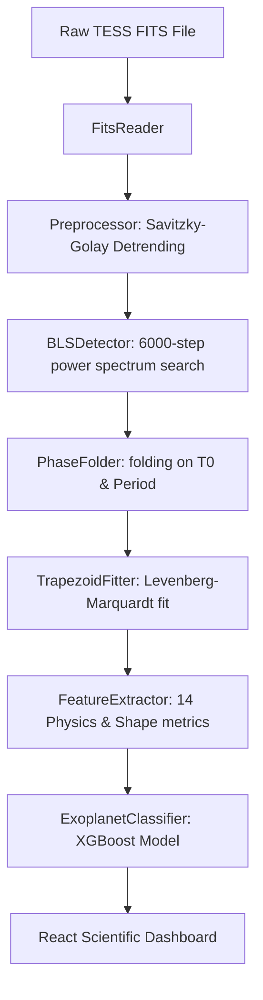

# Exoplanet Detection System (TESS Survey Transit Pipeline)

An end-to-end, scientifically calibrated exoplanet detection platform that reads raw NASA TESS (Transiting Exoplanet Survey Satellite) FITS files, preprocesses and detrends light curves, runs a Box Least Squares (BLS) transit search, fits a physical trapezoid model using Levenberg-Marquardt optimization, extracts 14 unified shape features, and runs them through a pre-trained XGBoost classifier to identify **Exoplanets (Planets)**, **Eclipsing Binaries (EBs)**, and **False Positives (FPs)**.

Includes a Flask API backend and an interactive, React-based scientific dashboard.

---

## Repository Architecture & Pipeline Stages



### 1. FITS Data Processing (`src/pipeline/fits_reader.py`)
Extracts time-series columns from standard TESS Light Curve files (HDU index 1 binary table):
- **Time** (`TIME` column in BJD - 2457000)
- **Flux** (`PDCSAP_FLUX` column, representing Pre-search Data Conditioning SAP flux)
- **Flux Error** (`PDCSAP_FLUX_ERR`)
- **Quality** (`QUALITY` bitmask flags)

---

### 2. Cleaning & Savitzky-Golay Detrending (`src/pipeline/preprocessing.py`)
Astronomical light curves suffer from slow instrumental wiggles (thermal drift, pointing wiggles) and stellar activity.
- **Quality Filtering**: Discards cadences where `QUALITY != 0` (bad data flags).
- **Savitzky-Golay Detrending**: Estimates the stellar baseline using a Savitzky-Golay filter (`window_length=1001`, `polyorder=2`).
- **Residual Center**: Produces `Normalized_Flux = Flux / Baseline` and relative residuals `Detrended_Flux = (Flux - Baseline) / Baseline` centered around `0.0`.

---

### 3. Box Least Squares (BLS) Transit Search (`src/pipeline/bls_detector.py`)
Scans the detrended light curve sector-by-sector for periodic, box-like transit dips.
- **Search Grid**: Searches a linear grid of **6,000 trial periods** between 0.5 and 15.0 days, and **50 trial durations** (approx. 1 to 12 hours).
- **Variance-Weighting**: Employs weighted BLS using `Normalized_Flux_Error` ($dy$) to discount high-noise frames.
- **Candidacy Selection**: Picks the sector showing the strongest periodic signal based on maximum BLS power.

---

### 4. Phase Folding & Trapezoid Transit Fitting (`src/pipeline/trapezoid_fit.py`, `src/pipeline/phase_folding.py`)
- **Phase Folding**: Folds the light curve around the detected period and epoch, centering the phase domain in `[-0.5, 0.5]`.
- **Trapezoidal Model Fitting**: Fits a physical trapezoid model (4 parameter state: depth, total duration, ingress duration, and mid-transit epoch) to the folded data inside a window cropped to 3 times the transit width using Levenberg-Marquardt least-squares optimization.

---

### 5. Unified Feature Engineering (`src/pipeline/feature_extractor.py`)
Extracts **14 physical and statistical parameters** representing transit symmetry, depths, and moments:
- `transit_duration_hours`, `ingress_duration_hours`, `depth_ppm`, `red_chi2` (goodness-of-fit), `rms_resid`.
- `ingress_fraction`: Ratio of ingress time to total duration.
- `flat_bottom_fraction`: Flat eclipsing duration over total duration (differentiates V-shaped EBs from flat-bottomed exoplanets).
- `transit_snr`: Ratio of depth to out-of-transit noise.
- `secondary_depth` & `secondary_snr`: Scans for secondary eclipses (identifies Eclipsing Binaries).
- `shape_rmse`: Left/right reflection RMS difference (quantifies asymmetry).
- `odd_even_ratio`: Compares odd and even transits (flags grazing binaries with alternating depths).
- `transit_skewness` & `transit_kurtosis`: In-transit shape descriptors.

---

### 6. Machine Learning Classification (`src/pipeline/classifier.py`)
Loads a frozen pre-trained XGBoost model (`src/models/final_xgboost.pkl`). Aligns features to the model's expected training vector:
- `0 -> Planet`
- `1 -> EB` (Eclipsing Binary)
- `2 -> False Positive`

---

## 7. Interactive API Server & Scientific UI

- **Flask Backend (`src/api.py`)**: Runs pipeline queries on upload, downsamples time series coordinates to exactly 500 points using a **peak-preserving index lock** to preserve narrow periodogram spikes.
- **Scientific Dashboard (`frontend/`)**: Renders:
  - **Target Metadata Banner**: Displaying TIC ID, sectors, best sector, AI prediction, and probability distributions.
  - **BLS Search Parameter Panel**: Dynamically retrieved search ranges, grid sizes, and weighting.
  - **Full-Width Spacious Plots**: Raw curve with red baseline overlay, detrended residuals with trapezoid model overlay, BLS periodogram with reference dashed lines and dot markers, and phase-folded overlay.
  - **Fullscreen Immersive Modal**: Allows expanding any chart for detailed inspection and PNG exports.

---

## How to Run Locally

### Prerequisites
- Python 3.9+
- Node.js 18+

### Setup & Run (Single Launcher Command)
1. Clone the repository and navigate to the project directory.
2. Install Python dependencies:
   ```bash
   pip install -r requirements.txt
   ```
3. Install Node launcher dependencies:
   ```bash
   npm install
   ```
4. Start both the Python API backend and React dev frontend concurrently:
   ```bash
   npm run dev
   ```
5. Open your browser and navigate to:
   **[http://localhost:5173](http://localhost:5173)** (or the port specified in the terminal).
